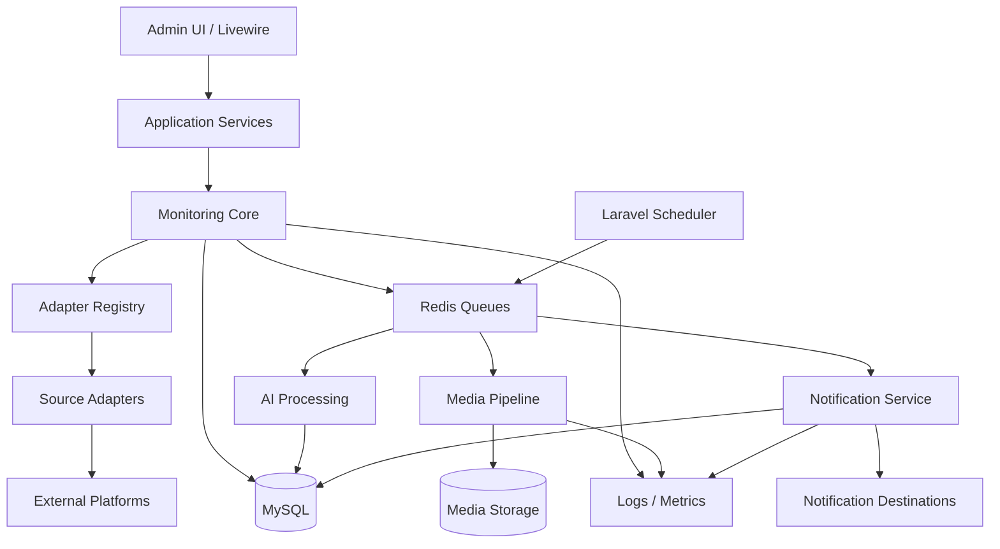
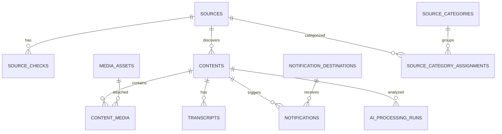
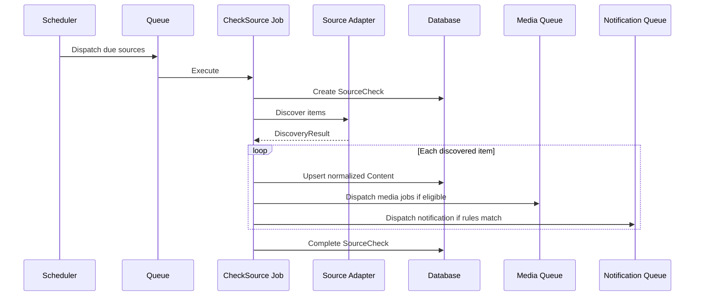

# RunyMediaMonitor — Architecture

> سند معماری فنی پروژه رصدیار (RunyMediaMonitor)
>
> وضعیت: Proposed Architecture · نسخه: 1.0  
> این سند مبنای طراحی و پیاده‌سازی است؛ جزئیات نهایی پس از بررسی Repository، مستندات APIها و تصمیم‌های فاز اول تثبیت می‌شوند.

## 1. چشم‌انداز و اصول معماری

RunyMediaMonitor یک سامانه ماژولار برای پایش منابع اینترنتی، کشف محتوای جدید، ذخیره Metadata، مدیریت رسانه، تحلیل اختیاری و ارسال اعلان است.

### اصول غیرقابل مذاکره

1. **Core مستقل از Provider:** منطق دامنه نباید به Instagram، YouTube یا Bale وابسته باشد.
2. **Adapter به‌ازای هر منبع:** هر پلتفرم پیاده‌سازی و محدودیت‌های خودش را دارد.
3. **Metadata مستقل از Media:** اگر دریافت فایل رسانه ممکن نبود، محتوای کشف‌شده همچنان باید ثبت شود.
4. **Async by default:** عملیات شبکه، پردازش رسانه، AI و ارسال اعلان در Queue اجرا شوند.
5. **Idempotency:** اجرای مجدد Job نباید محتوای تکراری یا اعلان تکراری تولید کند.
6. **Fail independently:** خطای AI یا ارسال اعلان نباید فرایند پایش و ذخیره محتوا را متوقف کند.
7. **Observable:** هر بررسی منبع، دریافت رسانه و ارسال اعلان باید قابل ردیابی باشد.
8. **Compliance first:** فقط از APIها و روش‌های مجاز استفاده شود؛ محدودیت دسترسی، نرخ درخواست و شرایط سرویس رعایت شوند.
9. **Incremental delivery:** پروژه در فازهای کوچک و قابل تست ساخته شود.

## 2. نمای سطح بالای سیستم



### مسئولیت لایه‌ها

| لایه | مسئولیت |
|---|---|
| Presentation | پنل مدیریت، فرم‌ها، داشبورد و نمایش وضعیت |
| Application | Use Caseها و هماهنگی عملیات |
| Domain | موجودیت‌ها، قواعد کسب‌وکار، قراردادها و رخدادها |
| Infrastructure | دیتابیس، Queue، Storage، HTTP و پیاده‌سازی Adapterها |
| Integrations | APIهای بیرونی، AI Providerها و مقصدهای اعلان |

وابستگی‌ها باید به سمت قراردادهای Domain باشد؛ لایه Domain نباید به Livewire یا SDK یک Provider وابسته شود.

## 3. ساختار پیشنهادی پروژه

ساختار زیر نقطه شروع پیشنهادی است و قبل از ایجاد فایل‌ها باید با ساختار واقعی Repository تطبیق داده شود.

```text
app/
  Domain/
    Monitoring/
      Contracts/
      DTOs/
      Enums/
      Events/
      Exceptions/
      Models/
      Services/
    Content/
    Media/
    Notifications/
  Application/
    Sources/
    Monitoring/
    Content/
    Media/
    Notifications/
    Reports/
  Infrastructure/
    Adapters/
      Instagram/
      YouTube/
      Web/
      Rss/
      Telegram/
      Bale/
      X/
    Persistence/
    Queue/
    Storage/
    Http/
  Jobs/
  Console/
    Commands/
  Livewire/
    Dashboard/
    Sources/
    Content/
    Media/
    Settings/
  Support/
config/
  media-monitor.php
  media-monitor-sources.php
database/
  migrations/
  factories/
  seeders/
resources/
  views/
  lang/
routes/
  web.php
  console.php
tests/
  Unit/
  Feature/
  Integration/
docs/
  ARCHITECTURE.md
  SOURCE-ADAPTERS.md
  SECURITY.md
```

از ساخت پوشه‌ها و کلاس‌های زیاد پیش از نیاز واقعی خودداری شود. ساختار باید با conventionهای Laravel هماهنگ باشد.

## 4. مدل دامنه و موجودیت‌ها

### موجودیت‌های اصلی

- **Source:** یک حساب، کانال، صفحه، وب‌سایت، Feed یا منبع قابل پایش.
- **SourceType:** نوع منبع مانند youtube یا instagram.
- **SourceCheck:** یک نوبت بررسی منبع با وضعیت، زمان و نتیجه.
- **Content:** محتوای کشف‌شده با هویت مستقل از رسانه.
- **ContentMedia:** ارتباط محتوا با یک یا چند فایل/رسانه.
- **MediaAsset:** فایل یا مرجع رسانه و وضعیت پردازش آن.
- **Transcript:** متن استخراج‌شده یا Subtitle در صورت دسترسی.
- **NotificationDestination:** مقصد ارسال مانند Bale Chat یا Channel.
- **Notification:** تلاش برای ارسال یک محتوا به یک مقصد.
- **Filter / FilterRule:** قواعد انتخاب و اولویت‌بندی محتوا.
- **AiProcessingRun:** نتیجه و وضعیت پردازش هوش مصنوعی.

### روابط کلیدی



### فیلدهای پیشنهادی

#### sources
- id
- source_type
- name
- url
- external_id nullable
- handle nullable
- category_id nullable یا رابطه چندبه‌چند
- config JSON
- credentials reference یا مقادیر رمزنگاری‌شده
- is_active
- check_interval_seconds
- last_checked_at
- last_successful_check_at
- next_check_at
- last_error nullable
- timestamps

#### source_checks
- id
- source_id
- status: pending, running, succeeded, partial, failed
- started_at, finished_at
- discovered_count, new_count
- error_code, error_message
- metadata JSON
- timestamps

#### contents
- id
- source_id
- external_id nullable
- content_type
- canonical_url
- original_url
- title nullable
- body nullable
- caption nullable
- author_name nullable
- published_at nullable
- discovered_at
- content_hash nullable
- raw_metadata JSON
- status
- timestamps

**قید یکتایی:** برای شناسه خارجی، در صورت وجود، unique ترکیبی روی source_id و external_id در نظر گرفته شود. برای منابع فاقد شناسه پایدار، یک کلید Deduplication نرمال‌شده و قابل توضیح ساخته شود؛ به URL یا Hash به‌تنهایی بدون تحلیل ماهیت منبع اتکا نشود.

#### media_assets
- id
- provider
- external_media_id nullable
- original_url nullable
- disk
- path nullable
- mime_type nullable
- size_bytes nullable
- checksum nullable
- duration_seconds nullable
- width nullable
- height nullable
- retrieval_status
- processing_status
- error_message nullable
- metadata JSON
- timestamps

#### content_media
- id
- content_id
- media_asset_id
- position
- role nullable

#### notification_destinations
- id
- driver
- name
- config JSON
- credentials encrypted
- is_active
- timestamps

#### notifications
- id
- content_id
- destination_id
- status
- idempotency_key
- attempts
- external_message_id nullable
- sent_at nullable
- last_error nullable
- timestamps

این Schema پیشنهادی است، نه دستور ایجاد فوری همه جداول. Migrationها باید بر اساس نیاز هر فاز و پس از بازبینی طراحی شوند.

## 5. قرارداد Source Adapter

هسته فقط با یک قرارداد پایدار کار کند. Adapter نباید مستقیماً رکوردهای Eloquent را ایجاد کند؛ خروجی استاندارد DTO تحویل Application Layer دهد.

نمونه مفهومی قرارداد:

```php
interface SourceAdapter
{
    public function type(): string;

    public function validate(SourceConfig $source): ValidationResult;

    public function capabilities(): AdapterCapabilities;

    public function discover(
        SourceConfig $source,
        ?string $cursor = null
    ): DiscoveryResult;

    public function fetchContent(
        SourceConfig $source,
        DiscoveredItem $item
    ): NormalizedContent;
}
```

قابلیت‌های اختیاری را از طریق قراردادهای جداگانه پیاده‌سازی کنید، نه اینکه همه Adapterها مجبور به پشتیبانی از همه عملیات باشند:

```php
interface MediaRetrievable
{
    public function retrieveMedia(
        SourceConfig $source,
        NormalizedContent $content,
        MediaReference $media
    ): MediaRetrievalResult;
}

interface TranscriptRetrievable
{
    public function retrieveTranscript(
        SourceConfig $source,
        NormalizedContent $content
    ): TranscriptResult;
}
```

نام‌ها و امضای نهایی با نسخه PHP و ساختار پروژه تطبیق داده شوند.

### DTOهای استاندارد

- SourceConfig
- AdapterCapabilities
- DiscoveryResult
- DiscoveredItem
- NormalizedContent
- MediaReference
- MediaRetrievalResult
- TranscriptResult
- AdapterError

DTOها باید نوع داده، فیلدهای ضروری و اطلاعات خطا را شفاف کنند. داده خام Provider در raw_metadata حفظ شود، اما منطق اصلی نباید به ساختار خام آن وابسته باشد.

### Adapter Registry

یک Registry یا Factory مسئول resolve کردن Adapter بر اساس source_type باشد. از شرط‌های پراکنده در Controllerها و Jobها برای انتخاب Provider اجتناب شود.

## 6. سیاست معماری برای Adapterهای مهم

### YouTube

YouTube Adapter یک Integration مستقل است و باید از API رسمی و مستند برای اطلاعاتی که API فراهم می‌کند استفاده کند.

- Channel و Playlist monitoring
- Video، Shorts و Live classification
- شناسه، عنوان، توضیحات، تاریخ انتشار و Thumbnail
- Transcript فقط در صورت دسترسی مجاز و با ذکر منبع/روش
- Media retrieval فقط برای محتوای متعلق به کاربر یا دارای مجوز و از مسیر مجاز
- در صورت غیرقابل دریافت بودن فایل، Content و Metadata ذخیره شوند
- وضعیت Metadata، Transcript و Media جداگانه نگهداری شود

### Instagram

- دسترسی بر اساس APIها و قابلیت‌های واقعاً مجاز و در دسترس
- تشخیص Post، Reel و Carousel در صورت ارائه داده کافی
- عدم تلاش برای دسترسی به حساب خصوصی یا دور زدن Login، محدودیت یا مکانیزم حفاظتی
- تغییرات API و محدودیت‌ها در Adapter محصور بمانند

### Web و RSS

- RSS/Atom و Sitemap با اولویت بر scraping
- رعایت robots.txt و سیاست دسترسی وب‌سایت
- محدودیت نرخ، Timeout و اندازه پاسخ
- کنترل Redirect و جلوگیری از SSRF
- استخراج Canonical URL و تاریخ انتشار
- Parse کردن HTML در یک لایه مجزا و تست‌پذیر

### Telegram و Bale

- استفاده از API و Bot API مستند و مجاز
- پشتیبانی از Pagination، Media Group و محدودیت حجم
- جداسازی Source Adapter از Notification Driver؛ خواندن محتوا و ارسال پیام دو مسئولیت مستقل هستند.

## 7. جریان کشف و ذخیره محتوا



### قواعد مهم

1. قبل از dispatch، فعال بودن Source و زمان بعدی بررسی کنترل شود.
2. از lock اتمیک برای جلوگیری از بررسی هم‌زمان یک Source استفاده شود.
3. Cursor یا checkpoint فقط پس از ثبت موفق داده‌های صفحه/بازه به‌روزرسانی شود.
4. شکست یک آیتم نباید کل batch را بی‌دلیل از بین ببرد.
5. نتیجه partial از failed تفکیک شود.
6. عملیات Upsert و ثبت وضعیت تا حد ممکن در Transaction مناسب انجام شود.
7. Jobها باید در برابر اجرای مجدد امن باشند.

## 8. Queueها و Jobها

Queueهای پیشنهادی:

| Queue | وظیفه |
|---|---|
| source-checks | کشف محتوا از منابع |
| content-normalization | نرمال‌سازی و ذخیره داده |
| media-retrieval | دریافت رسانه مجاز |
| media-processing | Thumbnail و Metadata |
| ai-processing | خلاصه‌سازی و طبقه‌بندی |
| notifications | ارسال اعلان |
| reports | تولید گزارش |

Jobهای احتمالی:
- ScheduleDueSources
- CheckSource
- NormalizeDiscoveredContent
- RetrieveMedia
- ProcessMedia
- GenerateTranscript
- AnalyzeContentWithAi
- SendContentNotification
- GenerateDailyReport

تنظیمات attempts، timeout، backoff و retry_after باید با زمان اجرای واقعی سرویس‌ها هماهنگ شوند. برای Jobهای غیرقابل تکرار، idempotency key و lock تعریف شود.

## 9. Media Pipeline

Media Pipeline باید از Adapter جدا باشد:

1. بررسی مجاز بودن Retrieval
2. Validate کردن URL و مقصد شبکه
3. بررسی MIME و Content-Length
4. دانلود Stream به فایل موقت در صورت مجاز بودن
5. محاسبه SHA-256 و Deduplication
6. انتقال به Storage نهایی
7. استخراج Metadata با ابزار مناسب
8. تولید Thumbnail در صورت نیاز
9. ثبت وضعیت و پاکسازی فایل موقت

وضعیت‌های پیشنهادی:
- pending
- skipped_not_supported
- skipped_not_authorized
- downloading
- downloaded
- processing
- ready
- failed

فایل‌ها نباید به‌صورت پیش‌فرض در public directory ذخیره شوند. Storage Driver از طریق Laravel Filesystem قابل تعویض باشد. FFmpeg فقط برای قابلیت‌هایی که واقعاً لازم هستند و پس از بررسی نصب و مجوز استفاده شود.

## 10. Notification Architecture

Notification Driver از Source Adapter مستقل باشد.

نمونه قرارداد مفهومی:

```php
interface NotificationDriver
{
    public function driver(): string;

    public function validateDestination(
        DestinationConfig $destination
    ): ValidationResult;

    public function send(
        DestinationConfig $destination,
        NotificationPayload $payload
    ): DeliveryResult;
}
```

### Bale Driver

- Token و Chat ID در تنظیمات امن
- قالب پیام قابل تنظیم
- ارسال متن و رسانه بر اساس API و محدودیت‌های واقعی
- ثبت شناسه پیام خارجی
- Retry کنترل‌شده و تشخیص خطاهای دائمی/موقت
- جلوگیری از ارسال دوباره با idempotency key

قالب و متن پیام نباید در Source Adapter ساخته شود؛ Notification Service مسئول ساخت Payload است.

## 11. AI Provider Architecture

AI یک قابلیت اختیاری و غیرمسدودکننده است.

- Provider interface مستقل
- پشتیبانی از OpenAI-compatible API و Providerهای دیگر
- Timeout و Token Budget
- ثبت مدل، زمان، هزینه تخمینی و نتیجه
- ذخیره خروجی ساختاریافته و اعتبارسنجی JSON
- امکان خاموش کردن AI برای هر Source یا کل سیستم
- عدم ارسال اطلاعات حساس یا Credentials به Provider

AI failure نباید Source Check، Content Persistence یا Notification پایه را متوقف کند.

## 12. Scheduler و محاسبه زمان بررسی

Scheduler باید در بازه کوتاه اجرا شود و فقط Sourceهای due را dispatch کند.

- next_check_at برای انتخاب سریع منابع آماده
- check_interval_seconds در سطح Source
- jitter اختیاری برای پخش بار
- سقف concurrency
- قفل توزیع‌شده
- ثبت زمان واقعی شروع و پایان
- به‌روزرسانی next_check_at با توجه به نتیجه و محدودیت Provider

از یک Job طولانی برای پیمایش تمام منابع استفاده نشود. هر Source یا batch کوچک باید Job مستقل داشته باشد.

## 13. امنیت

- اعتبارسنجی و Authorization برای عملیات پنل
- رمزنگاری Credentials با امکانات Laravel و عدم نمایش مجدد Secret
- عدم ثبت Token و Header حساس در Log
- جلوگیری از SSRF: رد localhost، private IP، link-local و مقصدهای ممنوع؛ بررسی DNS و Redirect در هر مرحله
- محدودیت scheme به HTTP/HTTPS در موارد لازم
- محدودیت اندازه، زمان و تعداد دانلود
- بررسی MIME واقعی فایل، نه فقط پسوند
- جلوگیری از Path Traversal
- عدم اجرای فایل دریافت‌شده
- محافظت از endpointهای مدیریتی و webhookها
- استفاده از HTTPS و مدیریت امن APP_KEY
- سیاست Retention و حذف امن رسانه
- رعایت Terms و API Policies پلتفرم‌ها

## 14. خطا، Logging و Observability

هر عملیات باید context قابل جستجو داشته باشد:
- source_id
- source_check_id
- content_id
- media_asset_id
- notification_id
- job_id
- provider
- correlation_id

خطاها دسته‌بندی شوند:
- Authentication
- Permission
- RateLimit
- Network / Timeout
- InvalidResponse
- NotFound / Deleted
- Unsupported
- Storage
- Processing
- Permanent / Transient

برای هر دسته سیاست Retry مشخص شود. Secretها و محتوای حساس در Log قرار نگیرند. داشبورد باید آخرین بررسی، موفقیت، خطا، تعداد محتوای جدید و وضعیت Queue را نشان دهد.

## 15. تست و کیفیت

- Unit Test برای Normalizer، Deduplication، Filters و DTOها
- Contract Test برای تمام Adapterها
- Feature Test برای مدیریت Source و Content Inbox
- Queue Test با Fake و Mock
- Integration Test با پاسخ‌های ذخیره‌شده و Mock HTTP
- تست Rate Limit، Timeout، Partial Failure و Retry
- تست SSRF و URL validation
- تست عدم ارسال Notification تکراری
- تست مستقل بودن AI و Media Failure از ذخیره Content

تست‌های معمول نباید بدون ضرورت به API واقعی یا حساب کاربری خارجی متصل شوند.

## 16. تنظیمات پیشنهادی

یک فایل config مرکزی برای تنظیمات عمومی داشته باشید، اما Credentials هر Source یا Destination باید در رکورد امن و رمزنگاری‌شده ذخیره شود.

نمونه کلیدهای تنظیمات عمومی:
- default_check_interval
- source_check_timeout
- max_concurrent_source_checks
- media_max_size
- media_allowed_mime_types
- queue_names
- retention_days
- ai_enabled
- notifications_enabled

مقادیر نمونه فقط پیش‌فرض هستند و باید با منابع واقعی و زیرساخت مقصد تنظیم شوند.

## 17. Roadmap اجرایی وابسته به معماری

### Phase 0 — Repository Assessment
- بررسی فایل‌ها و وابستگی‌های موجود
- شناسایی نسخه Laravel/PHP و الگوی کدنویسی
- بررسی وضعیت Git و تست‌ها
- تهیه گزارش ریسک و تصمیم‌های معماری

### Phase 1 — Core Foundation
- تنظیمات و مدل Source
- Source Adapter Contract و Registry
- SourceCheck و Logging
- Scheduler و Queue
- تست قرارداد و جریان اولیه

### Phase 2 — Content & Web/RSS
- Normalized Content
- Deduplication
- RSS/Atom و Website Adapter
- Content Inbox

### Phase 3 — YouTube
- بررسی دسترسی و API رسمی
- Channel/Playlist discovery
- Metadata و Thumbnail
- Transcript و Media policy

### Phase 4 — Instagram
- بررسی روش‌های مجاز و دسترسی واقعی
- Adapter مستقل
- نرمال‌سازی Post/Reel/Carousel در حد داده در دسترس

### Phase 5 — Telegram/Bale Sources
- Source Adapterها و تست‌ها

### Phase 6 — Media & Notifications
- Media Pipeline
- Bale Notification Driver
- Template و Delivery Logs

### Phase 7 — AI & Reports
- AI Provider
- Filters پیشرفته
- Daily Reports

### Phase 8 — Production Readiness
- Security review
- Backup/Restore
- Monitoring و Alerting
- Load و Failure testing
- Deployment documentation

## 18. تصمیم‌هایی که پیش از پیاده‌سازی باید تأیید شوند

1. نسخه دقیق Laravel و PHP بر اساس محیط استقرار
2. نوع و سطح دسترسی API برای هر Provider
3. منابع اولیه‌ای که در MVP پایش می‌شوند
4. مقصد و روش اتصال Bale Bot
5. Storage محلی یا S3-Compatible
6. حجم و Retention رسانه
7. سیاست AI و Providerهای مورد استفاده
8. نیاز به چند کاربر و سطح دسترسی‌ها
9. منابع زیرساختی و ظرفیت Redis/Queue/FFmpeg

## 19. دستورالعمل Coding Agent

در شروع کار:

1. این سند و README را بخوان.
2. Repository واقعی را بررسی کن؛ فرض نکن ساختار پیشنهادی از قبل وجود دارد.
3. نسخه‌ها و محدودیت‌های محیط را تأیید کن.
4. قبل از نصب Dependency یا تغییر Schema، دلیل و اثر آن را مشخص کن.
5. ابتدا فقط گزارش Assessment و طرح اجرای Phase 1 را ارائه بده.
6. بدون تأیید کاربر، کدنویسی گسترده یا تغییرات مخرب انجام نده.
7. هر فاز را با تست، مستندات و گزارش تغییرات تحویل بده.

---

**یادآوری:** این سند یک نقشه معماری پیشنهادی است، نه ادعای پشتیبانی قطعی پلتفرم‌ها. قابلیت هر منبع باید با API رسمی، دسترسی واقعی و شرایط سرویس در زمان پیاده‌سازی اعتبارسنجی شود.
